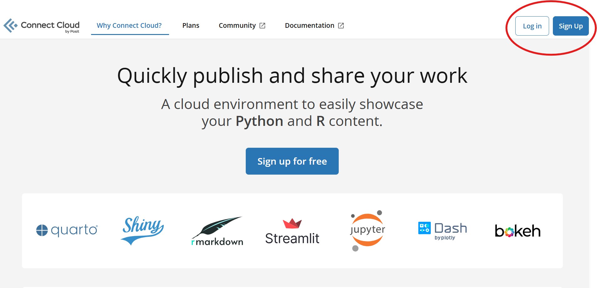
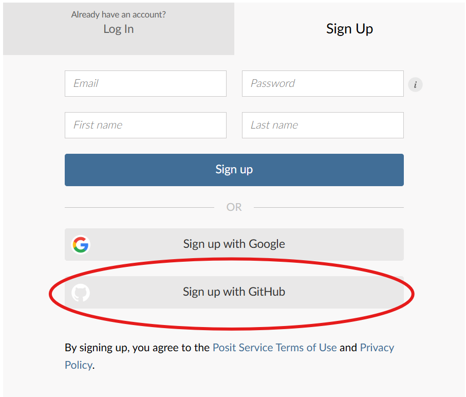
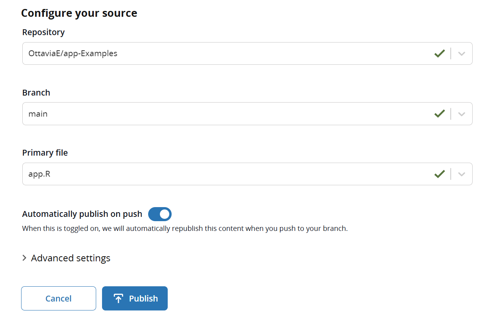

## Where to publish

Several servers can host a Shiny app ([overview by Posit](https://shiny.posit.co/r/articles/share/shiny-server/)). You can also build your own server from scratch, for instance following [Dean Attali's guide](https://deanattali.com/2015/05/09/setup-rstudio-shiny-server-digital-ocean/), but that requires some system administration.

We use **[Posit Connect Cloud](https://connect.posit.cloud/)**: it is free for public apps and publishes directly from GitHub. (You may also find *shinyapps.io*, the older Posit service: the logic is the same, but here we use Connect Cloud.)

## Step 1 · The account

Sign up on [Connect Cloud](https://connect.posit.cloud/) and choose **to sign in with GitHub**, so that Connect Cloud can see your repositories.

{fig-align="center" width="85%"}

{fig-align="center" width="85%"}

Follow the instructions and choose an account name.

## Step 2 · Publish

1. From the *Home* of your profile, click **Publish**
2. Choose **Shiny**
3. Select the **repository** (`my-shiny-app`), the **branch** (`main`) and the **primary file**: `app.R`
4. Click **Publish** and wait: Connect Cloud installs R and the packages listed in `manifest.json`, then starts the app

{fig-align="center" width="85%"}

When it is done, you get a **link**: that is your app, online. Open it from your phone, send it to a friend.

## Step 3 · Update the app

The online app is a copy of what is on GitHub. To change it:

1. edit the app in RStudio and check it with *Run App*
2. if you added packages: `rsconnect::writeManifest()`
3. commit + push with GitHub Desktop
4. on Connect Cloud, **republish** the content

## When something goes wrong

::: {.callout-warning}
## Troubleshooting

- **The repository is not in the list** → it is private, or Connect Cloud does not have access to it: check the GitHub permissions of Connect Cloud
- **"No manifest" / missing dependencies** → `manifest.json` is not in the repository: write it and push it
- **The app works on your computer but not online** → open the **logs** of the content on Connect Cloud: they show the R error. Common causes:
    - a package used in the app but not in the manifest (re-run `writeManifest()`)
    - a file read with an absolute path (`C:/Users/...`): use paths relative to the project
    - a file (data, images) that is on your computer but was not committed
- **The app starts but an output is empty** → it is a Shiny problem, not a deploy problem: go back to [the rules of the contract](../day1/02-logic.qmd#the-rules-of-the-contract)
:::

::: {.callout-tip}
## 🎉 Done

Your app is online. From here, [Going further](../extras/index.qmd) shows how to improve it: better layouts, interactive plots, downloads.
:::
